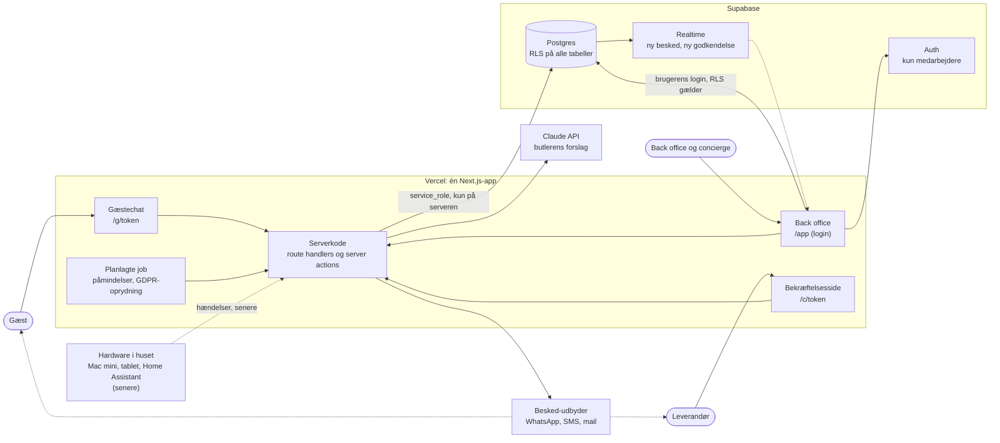
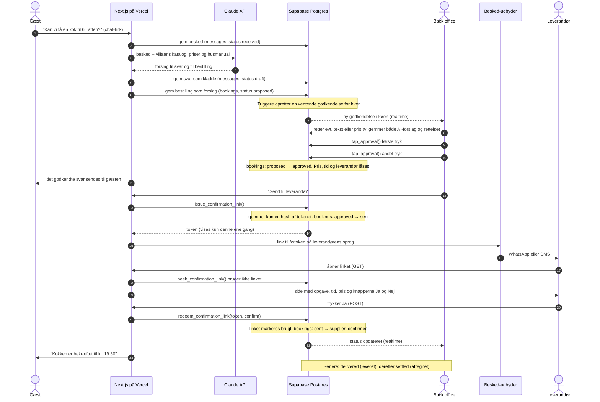
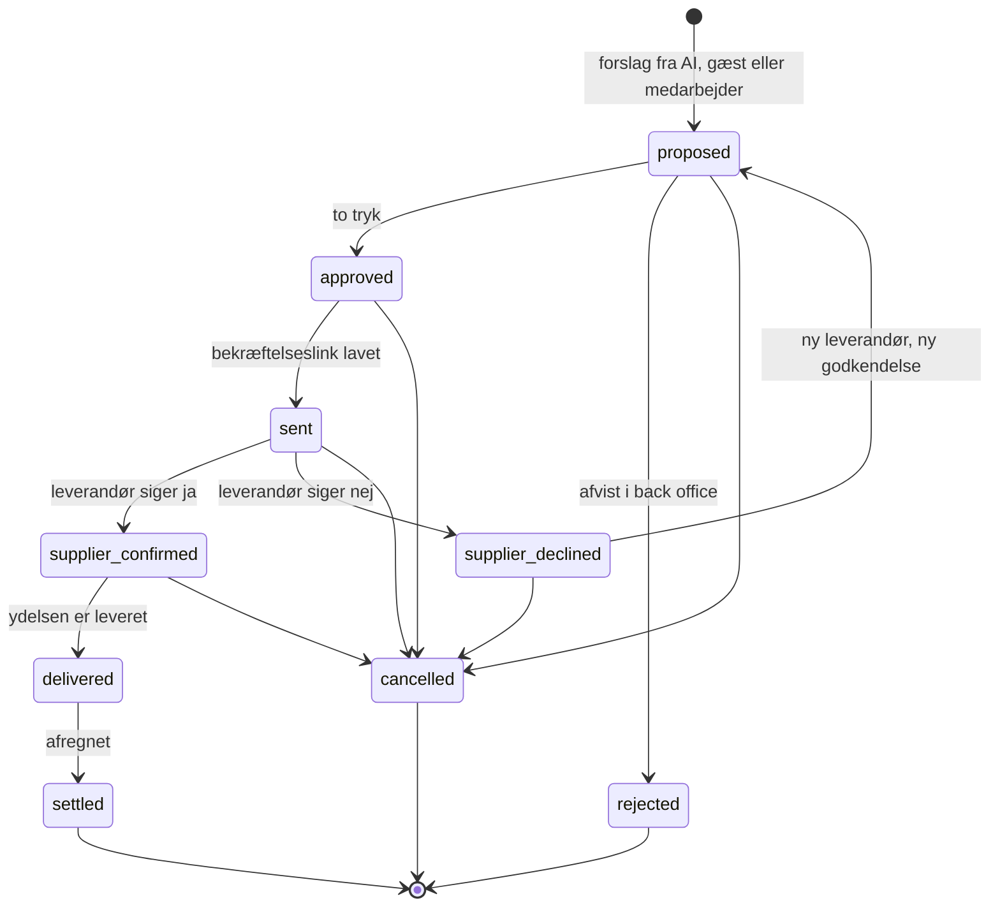
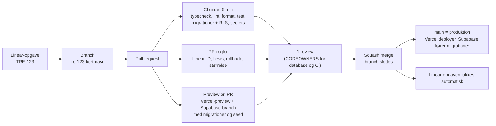

# Treatr: arkitektur

Treatr er en AI-butler til luksusvillaer. Gæsten taler med butleren, Hermes koordinerer back office og eskalerer kun det, den ikke selv kan, et menneske godkender med to tryk, og leverandøren bekræfter via et link uden login.

Dette dokument er overblikket. Detaljerne ligger her:

| Hvad                                  | Hvor                                                                   |
| ------------------------------------- | ---------------------------------------------------------------------- |
| Beslutninger og begrundelser          | [docs/adr/](docs/adr/)                                                 |
| Datamodel (diagram)                   | [docs/erd.md](docs/erd.md)                                             |
| Datamodel (kode)                      | [supabase/migrations/0001_init.sql](supabase/migrations/0001_init.sql) |
| Sådan arbejder vi (én side)           | [docs/saadan-arbejder-vi.md](docs/saadan-arbejder-vi.md)               |
| Første dag: fra clone til merget PR   | [docs/foerste-dag.md](docs/foerste-dag.md)                             |
| Opsætning af GitHub, Vercel, Supabase | [docs/opsaetning.md](docs/opsaetning.md)                               |
| Plan for ugen i Spanien               | [docs/5-dages-plan.md](docs/5-dages-plan.md)                           |
| Regler for AI-agenter                 | [AGENTS.md](AGENTS.md)                                                 |

## Antagelser

Otte åbne spørgsmål om idéen, og det svar vi har bygget på. Er et svar forkert, så ret det
her og i den ADR, der nævnes. De fleste kan ændres uden at røre datamodellen.

| #   | Spørgsmål                                        | Antaget svar                                                                                                                                                                                                                                                                                                             | Hvis det er forkert                                                                   |
| --- | ------------------------------------------------ | ------------------------------------------------------------------------------------------------------------------------------------------------------------------------------------------------------------------------------------------------------------------------------------------------------------------------ | ------------------------------------------------------------------------------------- |
| 1   | Hvordan taler gæsten med butleren?               | **Med stemmen, på mange sprog.** Det er produktets primære flade og wow-effekt (iPad i villaen og web-app via QR). Skrift er sekundært. Stemme-stacken vælges i Spanien. Stemmeleverandøren gemmer samtalen hos sig. "Glemmer ved checkout" gælder først, når leverandørens opbevaring er sat, før en rigtig gæst taler. | `conversations.channel` har allerede `whatsapp`, `sms`, `email` og `tablet`.          |
| 2   | Er "to tryk" én person eller to?                 | Én person, to bevidste tryk (Godkend, derefter Bekræft). En organisation kan kræve to forskellige personer.                                                                                                                                                                                                              | Sæt `organizations.require_two_approvers = true`.                                     |
| 3   | Hvad skal godkendes?                             | **Et menneske godkender med to tryk.** Hermes koordinerer back office som `concierge` (forslag, leverandører, opfølgning) og eskalerer det, den ikke selv kan, men kan ikke godkende. Automatisk godkendelse af sikre kategorier bliver senere en regel i databasen.                                                     | ADR-0014. Indtil koden er ændret, kræver databasen stadig to tryk (ADR-0007).         |
| 4   | Hvordan bekræfter leverandøren?                  | Får et link på WhatsApp, SMS eller mail. Siden viser opgaven og to knapper: ja og nej. Linket virker én gang og udløber efter 72 timer. Ringer leverandøren, kan back office registrere svaret.                                                                                                                          | Udløb er en parameter til `issue_confirmation_link`.                                  |
| 5   | Hvordan betaler gæsten?                          | Uden for systemet i piloten (faktura eller overførsel). Vi registrerer beløb, status og provision, men flytter ingen penge.                                                                                                                                                                                              | `payments.provider` er klar til en betalingsudbyder.                                  |
| 6   | Hvordan sættes priser?                           | Fast pris pr. service i EUR, som kan overstyres pr. villa. Ingen dynamisk prissætning.                                                                                                                                                                                                                                   | `villa_services.price_cents`.                                                         |
| 7   | Deler organisationer leverandører?               | Nej. Hver organisation har sine egne leverandører og sit eget katalog. Leverandører har ikke login.                                                                                                                                                                                                                      | Et fælles leverandørregister kræver en ny tabel og en ny ADR.                         |
| 8   | Hvornår slettes gæstedata, og hvem har ansvaret? | Persondata anonymiseres 30 dage efter udtjekning. Beløb og bestillinger bliver uden navne. Husejeren eller bureauet er dataansvarlig, Treatr er databehandler.                                                                                                                                                           | `organizations.guest_data_retention_days`. Få det bekræftet af en jurist før piloten. |

Tekniske antagelser: Linear-holdets nøgle er `TRE` (opgaver hedder `TRE-123`). Butleren bruger
Claude gennem Anthropics API fra serveren. Kode, tabeller og commits er på engelsk. Vejledninger
til holdet er på dansk.

## Overblik

Én Next.js-app på Vercel, én Postgres-database hos Supabase. Ingen andre servere.



De vigtigste regler i tegningen:

- **Medarbejdere logger ind** med Supabase Auth. Deres browser taler med databasen med deres
  eget login, så RLS afgør, hvad de kan se. De kan kun se deres egen organisation.
- **Gæster og leverandører logger aldrig ind.** De har et link med et hemmeligt token. Alt, hvad
  de gør, går gennem vores serverkode, som slår tokenet op. I databasen har rollen `anon` ingen
  rettigheder overhovedet (ADR-0006).
- **AI'en kan kun foreslå.** Butleren laver kladder og forslag. Databasen nægter at sende en
  AI-besked eller en bestilling videre uden to tryk fra et menneske (ADR-0007). Det gælder også Hermes, som har rollen `concierge` (ADR-0014).
- **Reglerne ligger i databasen**, ikke i hukommelsen: statusmaskine, godkendelse, engangs-token
  og adskillelse mellem organisationer er triggere, funktioner og RLS, som CI tester på hver PR.

## Dataflow: én bestilling fra besked til bekræftelse



Statusmaskinen for en bestilling. Kun pilene her er tilladt, og databasen afviser alt andet:



## Fra opgave til produktion



Hvert led er automatisk. Det eneste, et menneske skal huske, er at starte med en opgave i
Linear og kopiere branch-navnet derfra. Resten enten sker af sig selv eller bliver afvist
med en besked om, hvad der mangler. Se ADR-0002, ADR-0003 og ADR-0004.

## Miljøer

| Miljø      | App                             | Database                                                                                           | Data                |
| ---------- | ------------------------------- | -------------------------------------------------------------------------------------------------- | ------------------- |
| Lokalt     | `npm run dev`                   | `npx supabase start` (Docker på din egen maskine)                                                  | `supabase/seed.sql` |
| Preview    | Vercel-preview pr. pull request | Samme Supabase-projekt som produktion, indtil Supabase Pro er valgt. Ingen rigtige data i piloten. | `supabase/seed.sql` |
| Produktion | Vercel, deployes fra `main`     | Supabase-projektet, migreres fra `main`                                                            | Rigtige data        |

Der er ingen fælles "staging". En preview pr. PR gør det samme, uden at fem mennesker deler
én database. Ingen har grund til at røre produktionsdata, og agenter bliver stoppet af en
hook, hvis de prøver (`.claude/hooks/guard.mjs`).

## Mappestruktur

Det, der findes nu, og hvor resten skal ligge. Hver person ejer sine egne mapper i ugen
(se [5-dages-planen](docs/5-dages-plan.md)), så vi ikke retter i de samme filer.

```
src/app/app/            back office (kræver login)               bygges i uge 1
src/app/g/[token]/      gæstens chat                             bygges i uge 1
src/app/c/[token]/      leverandørens bekræftelsesside           bygges i uge 1
src/app/api/            webhooks og planlagte job                bygges i uge 1
src/lib/supabase/       database-klienter. admin.ts bruger service_role (CODEOWNERS)
src/lib/butler/         AI-butleren: prompt, værktøjer, forslag
src/lib/i18n.ts         oversatte tekster (findes, med test)
supabase/migrations/    databaseskemaet. Nye filer, aldrig rettelser
supabase/seed.sql       demo-villa til lokal udvikling og previews
tests/db/               RLS- og regeltests, som CI kører på en tom Postgres
.github/                CI, PR-regler, ruleset, CODEOWNERS, PR-skabelon
.claude/                hooks og skills til agenter
docs/                   ADR'er, ERD, vejledninger
```

## Datamodellen kort

Diagram og forklaring står i [docs/erd.md](docs/erd.md). De bærende idéer:

- **Multi-tenant fra dag 1.** Alle tabeller har `organization_id`. RLS bruger tre faste mønstre
  (medlem, leder, ejer). Sammensatte fremmednøgler gør det umuligt at koble en række til en
  anden organisations villa eller gæst, også for serverkode (ADR-0005).
- **Roller.** `owner` (alt, inkl. medlemmer og audit-log), `back_office` (godkender, katalog,
  leverandører, penge), `concierge` (samtaler, gæster, forslag, men ingen godkendelse og ingen penge).
- **AI-forslag og rettelser gemmes.** `messages.ai_suggested_body` er det, butleren foreslog.
  `messages.body` er det, der blev sendt. `was_edited` fortæller, om mennesket rettede.
- **Mersalg måles.** `upsell_offers` gemmer hvert tilbud, hvornår det blev vist, og om gæsten
  sagde ja. Viewet `upsell_performance` viser, hvad der virker pr. service og tidspunkt.
- **GDPR.** `purge_expired_guest_data()` anonymiserer gæster efter fristen. Audit-loggen gemmer
  aldrig gæstens fritekst (ADR-0009).
- **Home Assistant.** `devices` og `home_events` findes, men intet skriver til dem endnu (ADR-0013). Hardwaren i piloten er Pi som hub, iPad og Jabra i villaen, Mac mini som back office (ADR-0015). Hvad der kører hvor, og hvorfor Hermes ikke er i gæstens samtale: ADR-0016.

## Det springer vi bevidst over

| Springes over                                     | Hvorfor                                                                            |
| ------------------------------------------------- | ---------------------------------------------------------------------------------- |
| Fælles staging-miljø                              | Preview pr. PR dækker behovet uden delt tilstand.                                  |
| Monorepo, mikrotjenester, kø-system               | Én app og en `notifications`-tabel som udbakke er nok til piloten.                 |
| ORM (Prisma, Drizzle)                             | Supabase-klienten og genererede typer er standarden. SQL-migrationer er sandheden. |
| Betalingsudbyder                                  | Kun struktur nu. Vælges, når piloten viser, hvordan gæster vil betale.             |
| Login til leverandører og gæster                  | Links med token er nemmere for dem og sikrere for os i piloten.                    |
| Dynamisk prissætning                              | Ikke en del af idéen.                                                              |
| End-to-end-tests i browser (Playwright)           | Kommer, når der er skærme at teste. Indtil da: enhedstests og databasetests.       |
| Merge queue, kode-scanning med CodeQL             | Kræver dyrere planer. Gitleaks og `npm audit` er den simple scanning.              |
| Tjek af commit-beskeder, changelog, versionsnumre | Squash merge giver én commit pr. PR med PR-titlen. Det er nok.                     |
| Feature flags, Storybook, komponentbibliotek      | Tilføjes, når et konkret behov viser sig.                                          |
| Automatisk tjek af genererede database-typer i CI | Kræver hele Supabase i CI og sprænger 5 minutter. Typerne genereres lokalt.        |
| Integration til Home Assistant                    | Senere. Skemaet har plads.                                                         |

## Status

**Klar og afprøvet**

- Databaseskema med 25 tabeller, enums, indeks, RLS, statusmaskine, to-tryks-godkendelse,
  bekræftelseslinks, audit-log og GDPR-anonymisering. Kørt mod en tom Postgres 16 og 17 med
  154 automatiske tjek.
- Seed-data for én demo-villa med tre demo-logins.
- CI-workflow (4 job), PR-regler (Linear-ID, bevis, rollback, størrelse) og Main-vagt. Tjekket
  med actionlint. PR-reglerne er afprøvet lokalt med 8 eksempler.
- Ruleset for `main` som JSON, CODEOWNERS, PR-skabelon, Dependabot og et opsætningsscript.
- Lokale git-hooks (lefthook) og en Claude Code-hook, der blokerer push til main, ændring af
  gamle migrationer, `.env`-filer og kommandoer mod produktion.
- AGENTS.md, CLAUDE.md, CONTRIBUTING.md, "Sådan arbejder vi", "Første dag" og 5-dages-plan.
- Et tomt Next.js-skelet, hvor `npm run check` er grøn.

**Mangler (skal gøres af holdet)**

- Oprette GitHub-repo, Vercel-projekt, Supabase-projekt og Linear-hold og koble dem sammen.
  Trin for trin i [docs/opsaetning.md](docs/opsaetning.md). Intet af det er gjort herfra.
- Vælge plan-niveau. Rulesets, preview branches og hold-deploys koster penge på et privat repo.
- Rette `@treatr/erfarne` i `.github/CODEOWNERS` til det rigtige team.
- Selve appen: back office, gæstechat, bekræftelsesside og butlerens AI-kald.
- Afsendelse af WhatsApp, SMS og mail (udbyder er ikke valgt).
- Planlagt job, der kalder `purge_expired_guest_data()` dagligt.

**De tre største risici**

1. **Gratis-planerne håndhæver ikke reglerne.** På et privat repo uden GitHub Team er rulesettet
   kun en fil. Uden Supabase Pro er der ingen preview branch pr. PR. Uden Vercel Pro kan holdet
   ikke deploye fra et privat organisations-repo. Det mindste, der gør main reelt beskyttet,
   er GitHub Team til 20 USD om måneden. Se ADR-0002 og ADR-0003. Vercel Hobby deployer muligvis ikke kollegers commits (git author uden adgang til projektet). Testes onsdag med en kollegas PR, ikke Magnus'.
2. **`service_role` går uden om RLS.** Gæstechatten, bekræftelsessiden og butleren kører på
   serveren med en nøgle, der kan se alle organisationer. Én glemt `organization_id` i den
   kode kan vise én kundes data til en anden. Derfor: al sådan kode samles i `src/lib/supabase/`,
   kræver review af en erfaren, og de sammensatte fremmednøgler stopper de værste fejl.
3. **Skemaet er afprøvet mod ren Postgres, ikke mod en rigtig Supabase.** Testen efterligner
   Supabases roller og `auth`-skema. Seed-filens demo-logins og samspillet med Supabase Auth
   er ikke kørt for alvor. Første punkt på dag 1 er `npx supabase start` og et login.
