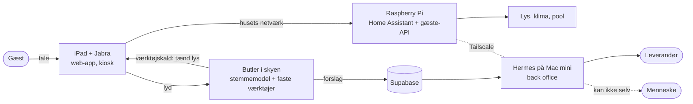

# iPad er tynd, Pi'en ejer huset, butleren er en API, Hermes er bag kulissen

Status: besluttet af Magnus 18/11/2026. Bygger på ADR-0014 og ADR-0015.

## Beslutning

| Enhed                             | Kører                                                                                                                                                   | Kører ikke                                                                       |
| --------------------------------- | ------------------------------------------------------------------------------------------------------------------------------------------------------- | -------------------------------------------------------------------------------- |
| iPad (væghængt, Jabra i USB-C)    | Web-app i kiosk-tilstand. Stemmen streames direkte til en stemmemodel i skyen. Smart home-knapper kalder Pi'en på husets netværk.                       | Ingen logik, ingen data. Går den i stykker, sættes en ny op.                     |
| Raspberry Pi (i villaen)          | Home Assistant. En lille API med en hvidliste over det, en gæst må (lys, klima, gardiner, pool), ikke alarm, lås eller kameraer. Tailscale ud af huset. | Ingen gæstedata, ingen samtaler.                                                 |
| Butleren (skyen, Vercel/Supabase) | Stemmesamtalen med faste værktøjer: husinfo, smart home, foreslå bestilling, eskalér.                                                                   | Ingen hukommelse om gæsten efter checkout.                                       |
| Mac mini (back office, Danmark)   | Hermes: leverandører, opfølgning, eskalering til et menneske (ADR-0014). Overvåger og opdaterer Pi'erne.                                                | Er ikke med i gæstens samtale. Er den nede, kan gæsten stadig tale med butleren. |

## Hvorfor Hermes ikke kører på iPad'en

- **Hastighed:** en stemmesamtale skal svare på under et sekund. Hermes arbejder i flere omgange.
- **Forudsigelighed:** Hermes lærer om sin bruger og ændrer sine skills. Over for en fremmed gæst skal butleren opføre sig ens og glemme ved checkout.
- **Platform:** iPadOS kan ikke køre Hermes som en server.
- **Ansvar:** faste værktøjer gør det tydeligt, hvad butleren kan (AI Act).

Butleren sender det, den ikke kan, videre til Hermes og siger "jeg vender tilbage".

## Smart home-kommandoer bliver i huset

Når stemmemodellen kalder værktøjet "tænd lyset", udfører iPad'en kaldet mod Pi'en på husets netværk. Kommandoen går ikke ud af huset og ind igen, så lyset reagerer straks, også på en langsom forbindelse. Pi'ens API afviser alt, der ikke står på hvidlisten.

## Hvad kræver smart home på Pi'en

Home Assistant kan installeres på Pi'en uden ekstra hardware og styrer straks alt, der taler wifi eller kabel: Shelly-relæer, mange wifi-stik og -pærer, Sonos, smart-tv, aircondition med wifi og Matter over wifi. Pi'ens Bluetooth dækker nogle Bluetooth-enheder.

Ekstra hardware kræves kun til:

- **Zigbee, Thread eller Z-Wave** (fx IKEA, Aqara, Hue uden bro): en USB-dongle.
- **Stabil drift i en udlejningsvilla:** en SSD i stedet for SD-kort, officiel strømforsyning og kabel til routeren. Ikke nødvendigt til demoen.
- **Villaens eksisterende anlæg** (fx KNX, Loxone, Lutron): Home Assistant har integrationer, men det kræver adgang til anlæggets gateway.

## Prioritet i Spanien

Én stemmesamtale og én lyskommando hele vejen fra iPad over Pi til lampen er det stærkeste demo-øjeblik. Bådbestillingen kører ved siden af.
