# Datamodel (ERD)

Diagrammet viser tabellerne og de vigtigste kolonner. Den fulde sandhed er
[supabase/migrations/0001_init.sql](../supabase/migrations/0001_init.sql).

Alle tabeller undtagen `organizations` og `profiles` har `organization_id`, og alle har RLS.
For at holde diagrammet læsbart er `organization_id`, `created_at` og `updated_at` udeladt.

```mermaid
erDiagram
  organizations ||--o{ organization_members : "har medlemmer"
  profiles ||--o{ organization_members : "er medlem af"
  organizations ||--o{ villas : "ejer"
  villas ||--o{ villa_amenities : "har faciliteter"
  organizations ||--o{ guests : "har gæster"
  villas ||--o{ stays : "huser"
  guests ||--o{ stays : "bor i"
  organizations ||--o{ services : "tilbyder"
  villas ||--o{ villa_services : "pris pr. villa"
  services ||--o{ villa_services : "tilbydes i"
  organizations ||--o{ suppliers : "bruger"
  suppliers ||--o{ supplier_services : "leverer"
  services ||--o{ supplier_services : "leveres af"
  stays ||--o{ conversations : "har samtaler"
  guests ||--o{ conversations : "skriver i"
  conversations ||--o{ messages : "består af"
  stays ||--o{ upsell_offers : "får tilbud"
  services ||--o{ upsell_offers : "tilbydes som mersalg"
  stays ||--o{ bookings : "har bestillinger"
  services ||--o{ bookings : "bestilles"
  suppliers ||--o{ bookings : "udfører"
  upsell_offers |o--o{ bookings : "blev til"
  bookings ||--o{ booking_status_events : "historik"
  bookings ||--o{ approvals : "godkendes med to tryk"
  messages ||--o{ approvals : "godkendes med to tryk"
  bookings ||--o{ confirmation_links : "bekræftes via"
  suppliers ||--o{ confirmation_links : "modtager"
  bookings ||--o{ payments : "betales med"
  bookings ||--o{ commissions : "giver provision"
  organizations ||--o{ notifications : "sender"
  organizations ||--o{ audit_log : "logger"
  guests ||--o{ gdpr_requests : "beder om"
  villas ||--o{ devices : "har hardware"
  devices ||--o{ home_events : "sender hændelser"

  organizations {
    uuid id PK
    text name
    text slug UK
    locale_code default_locale
    int guest_data_retention_days "GDPR-frist, standard 30"
    boolean require_two_approvers "to personer i stedet for to tryk"
  }
  profiles {
    uuid id PK "samme id som auth.users"
    text full_name
    locale_code locale
  }
  organization_members {
    uuid id PK
    uuid user_id FK
    org_role role "owner, back_office, concierge"
  }
  villas {
    uuid id PK
    text name
    text slug
    text city
    int max_guests
    jsonb description_i18n "es, en, da"
    jsonb house_rules_i18n
  }
  villa_amenities {
    uuid id PK
    uuid villa_id FK
    text key "pool, wifi, bbq"
    jsonb name_i18n
    jsonb details_i18n "butlerens husmanual"
  }
  guests {
    uuid id PK
    text full_name
    text email
    text phone
    locale_code locale
    timestamptz anonymized_at "sat ved GDPR-sletning"
  }
  stays {
    uuid id PK
    uuid villa_id FK
    uuid primary_guest_id FK
    date check_in
    date check_out
    stay_status status
    text guest_token_hash "gæstens chat-link"
    timestamptz purged_at
  }
  services {
    uuid id PK
    service_category category "chef, transport, cleaning, experience, shopping"
    jsonb name_i18n
    int default_price_cents
    price_unit price_unit
    boolean upsell_eligible
  }
  villa_services {
    uuid id PK
    uuid villa_id FK
    uuid service_id FK
    int price_cents "tom = standardpris"
    boolean available
  }
  suppliers {
    uuid id PK
    text name
    text phone
    notification_channel preferred_channel
    locale_code locale
    int commission_rate_bps
  }
  supplier_services {
    uuid id PK
    uuid supplier_id FK
    uuid service_id FK
    uuid villa_id FK "tom = alle villaer"
    int cost_cents
    int priority
  }
  conversations {
    uuid id PK
    uuid stay_id FK
    uuid guest_id FK
    conversation_channel channel "web, whatsapp, sms, email, tablet"
    locale_code locale
    uuid assigned_to FK
  }
  messages {
    uuid id PK
    uuid conversation_id FK
    message_sender sender_type "guest, butler_ai, staff, system"
    message_status status "received, draft, approved, sent"
    text body "det endelige svar"
    text ai_suggested_body "det AI'en foreslog"
    boolean was_edited "rettede mennesket?"
    text ai_model
  }
  upsell_offers {
    uuid id PK
    uuid stay_id FK
    uuid service_id FK
    text trigger_kind "pre_arrival, mid_stay, in_conversation"
    text variant "hvilken formulering"
    upsell_status status "suggested, shown, accepted, declined"
    int price_cents
  }
  bookings {
    uuid id PK
    uuid stay_id FK
    uuid service_id FK
    uuid supplier_id FK
    uuid upsell_offer_id FK
    booking_status status "statusmaskinen"
    timestamptz scheduled_start
    int guest_price_cents
    int supplier_cost_cents
    int margin_cents "beregnet"
  }
  booking_status_events {
    bigint id PK
    uuid booking_id FK
    booking_status from_status
    booking_status to_status
    actor_type actor_type "staff, supplier, ai, system"
    uuid actor_user_id FK
  }
  approvals {
    uuid id PK
    approval_subject subject_type "booking eller message"
    uuid booking_id FK
    uuid message_id FK
    approval_status status "pending, first_tap, approved, rejected"
    uuid first_tap_by FK
    timestamptz first_tap_at
    uuid second_tap_by FK
    timestamptz second_tap_at
    jsonb snapshot "præcis hvad der blev godkendt"
  }
  confirmation_links {
    uuid id PK
    uuid booking_id FK
    uuid supplier_id FK
    text token_hash UK "sha256, aldrig det rå token"
    timestamptz expires_at
    timestamptz used_at "sat første gang, aldrig igen"
    text used_action "confirmed eller declined"
    timestamptz revoked_at
  }
  payments {
    uuid id PK
    uuid booking_id FK
    payment_direction direction "guest_payment, supplier_payout, refund"
    int amount_cents
    payment_status status
    text provider "tom indtil udbyder er valgt"
  }
  commissions {
    uuid id PK
    uuid booking_id FK
    commission_kind kind
    int rate_bps
    int amount_cents
    commission_status status
  }
  notifications {
    uuid id PK
    recipient_type recipient_type "staff, guest, supplier"
    notification_channel channel
    text template_key
    locale_code locale
    notification_status status "queued, sent, failed, read"
  }
  audit_log {
    bigint id PK
    actor_type actor_type
    uuid actor_user_id
    text action
    text table_name
    uuid record_id
    jsonb old_data "uden persondata"
    jsonb new_data
  }
  gdpr_requests {
    uuid id PK
    uuid guest_id FK
    gdpr_request_type request_type "erasure, export"
    timestamptz completed_at
  }
  devices {
    uuid id PK
    uuid villa_id FK
    device_kind kind "mac_mini, tablet, home_assistant"
    timestamptz last_seen_at
  }
  home_events {
    bigint id PK
    uuid villa_id FK
    uuid device_id FK
    text event_type
    jsonb payload
    timestamptz occurred_at
  }
```

## Hvem må hvad (RLS)

`anon` (ikke logget ind) har ingen adgang til noget. Serveren bruger `service_role` til gæster,
leverandører og butleren.

| Tabeller                                                                                               | Concierge                        | Back office    | Ejer           |
| ------------------------------------------------------------------------------------------------------ | -------------------------------- | -------------- | -------------- |
| `villas`, `villa_amenities`, `services`, `villa_services`, `suppliers`, `supplier_services`, `devices` | læse                             | læse og skrive | læse og skrive |
| `guests`, `stays`, `conversations`, `upsell_offers`                                                    | læse og skrive                   | + slette       | + slette       |
| `messages`                                                                                             | læse, skrive egne, rette kladder | det samme      | det samme      |
| `bookings`                                                                                             | læse, foreslå, rette forslag     | + rette alle   | + rette alle   |
| `approvals`, `booking_status_events`, `home_events`                                                    | læse                             | læse           | læse           |
| Godkende med to tryk (`tap_approval`, `reject_approval`)                                               | nej                              | ja             | ja             |
| `confirmation_links`                                                                                   | nej                              | læse           | læse           |
| `payments`, `commissions`, `gdpr_requests`                                                             | nej                              | læse og skrive | læse og skrive |
| `notifications`                                                                                        | egne                             | alle           | alle           |
| `organization_members`, `organizations`                                                                | læse                             | læse           | læse og skrive |
| `audit_log`                                                                                            | nej                              | nej            | læse           |

## Funktioner appen kalder

| Funktion                                   | Hvem                      | Hvad                                                                     |
| ------------------------------------------ | ------------------------- | ------------------------------------------------------------------------ |
| `tap_approval(approval_id)`                | ejer, back office         | Ét tryk. Andet tryk godkender bestillingen eller beskeden.               |
| `reject_approval(approval_id, reason)`     | ejer, back office         | Afviser. Bestillingen lukkes, eller kladden kasseres.                    |
| `issue_confirmation_link(booking_id, ttl)` | ejer, back office, server | Laver linket, returnerer tokenet én gang, sætter bestillingen til sendt. |
| `peek_confirmation_link(token)`            | kun server                | Viser hvad linket handler om, uden at bruge det.                         |
| `redeem_confirmation_link(token, action)`  | kun server                | Bruger linket. Virker præcis én gang.                                    |
| `anonymize_guest(guest_id)`                | kun server                | Fjerner persondata for én gæst.                                          |
| `purge_expired_guest_data()`               | kun server (dagligt job)  | Anonymiserer alle gæster, der er forbi fristen.                          |
| `i18n(tekst, sprog)`                       | alle                      | Henter tekst på et sprog med fallback til en, es, da.                    |

## Tilføj en tabel

Kopiér mønsteret fra en tabel, der ligner. CI (`tests/db/50_schema_rules.sql`) afviser en
migration, hvis en ny tabel mangler `organization_id`, RLS, en policy, eller et indeks på en
fremmednøgle, eller hvis `anon` får rettigheder.
